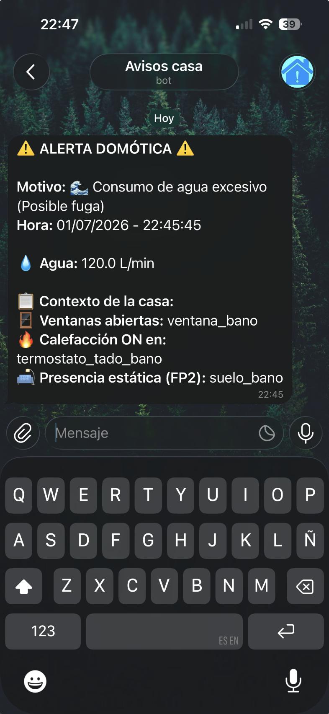

# 🏠 Sistema Domótico Inteligente con Supervisión de Anomalías


Sistema domótico proactivo orientado a la **seguridad**, la **asistencia no invasiva** y la **eficiencia energética** en el hogar. Procesa la telemetría de la vivienda en tiempo real de forma **100 % local (Edge Computing)** y combina un **motor de reglas deterministas** con **aprendizaje automático no supervisado (Isolation Forest con perfil contextual de rutinas)** para detectar tanto emergencias técnicas inmediatas como desviaciones conductuales sin recurrir a cámaras.

> **Trabajo de Fin de Grado** — Grado en Ingeniería Informática de Servicios y Aplicaciones  
> Escuela de Ingeniería Informática de Segovia, Universidad de Valladolid (2026)  
> **Autor:** Daniel López Iniesta

---

## Arquitectura del Sistema

El ecosistema se organiza en **cinco capas desacopladas** y un modelado por dominios (**DDD**: *Energía, Seguridad, Confort, Salud y Agua*):

1. **Percepción:** Radar de presencia estática por ondas milimétricas (**Aqara FP2** sobre Wi-Fi local), contactos magnéticos de puertas/ventanas, enchufes con monitorización de potencia y termostatos inteligentes (**tado° X**).
2. **Transporte:** Red local **Wi-Fi** (Aqara FP2), malla **Zigbee** (Aqara Hub M3) y malla **Thread / Matter** (tado° Bridge X).
3. **Middleware:** **Home Assistant** unifica la telemetría heterogénea y envía el estado en JSON al servidor local cada minuto (o en actualizaciones parciales por evento).
4. **Núcleo Inteligente (este repositorio):** API asíncrona en **FastAPI** protegida por `X-API-Key` (comparación en tiempo constante y modo *fail-closed*), persistencia en **SQLite (modo WAL)** con fusión recursiva (*Deep Update*) y motor híbrido Reglas → IA.
5. **Notificación:** Bot de **Telegram** asíncrono (`httpx`) con alertas HTML escapadas de forma segura, soporte para alertas simultáneas, índice de gravedad IA y control atómico de *cooldown* (por defecto `300 s`).


---

## Motor de Decisión Híbrido

Cada petición recibida en `POST /detect` (validada con esquemas estrictos de **Pydantic v2**) actualiza el estado persistente mediante *Deep Update* —conservando las claves no enviadas y evitando sobrescrituras por diccionarios vacíos— y pasa por dos capas secuenciales:

### 1. Capa Determinista ([`src/core/rules.py`](src/core/rules.py))

Evalúa **todas** las reglas ordenadas por prioridad (sin ocultar emergencias simultáneas) con *bypass* inmediato a la capa predictiva:

| Regla | Código | Condición técnica | Gravedad |
| :--- | :--- | :--- | :--- |
| **Fuga crítica de agua** | `water_critical_high` | Caudal `> 15,0 L/min` | Crítica |
| **Sobrecarga eléctrica** | `power_high` | Potencia global `>= 3500 W` | Crítica |
| **Inactividad anómala** | `presence_no_motion` | Presencia en franja `08:00–22:00` con `> 3600 s` sin movimiento | Alta |
| **Seguridad (olvido/intrusión)** | `security_element_open_away` | Vivienda vacía (`presence == 0`) con puerta o ventana abierta | Alta |
| **Derroche térmico** | `efficiency_heating_window_open` | Calefacción encendida con ventana abierta | Moderada |

### 2. Capa Predictiva ([`src/models/`](src/models/))

Si ninguna regla determinista salta, el estado se proyecta a **14 características** que combinan:

- **Perfil contextual no supervisado** (`fit_routine_profile`, ajustado únicamente sobre datos de entrenamiento por `(hora, fin_de_semana, presencia)`):
  - Exceso robusto fuera del rango `[P01, P99]` para variables continuas (`water_L_per_min`, `power_W`).
  - Autoinformación de Shannon (`-log P`) para variables binarias (`motion`, `window_open`, `door_open`, `heating_on`, `fp2_active`, `presence`) más agregados `max` y `sum`.
- **Codificación temporal cíclica real:** `hour_sin`, `hour_cos`, `weekday_sin`, `weekday_cos`.

El vector se evalúa en O(1) con **Isolation Forest** (`n_estimators=200`, `max_samples=2048`, `contamination=0,4 %`, sin `StandardScaler` al ser invariante para árboles paralelos a los ejes). En Telegram, el *score* negativo se reescala a una severidad interpretable en `[0, 1]` (`CRÍTICO > 0,75`, `ALTO 0,60–0,75`, `MODERADO <= 0,60`).

---

## Evaluación Reproducible y Rendimiento

El repositorio incluye un simulador anual por bloques realistas ([`src/simulate_yearly.py`](src/simulate_yearly.py), **525.600 minutos**) y un script de evaluación reproducible ([`src/models/evaluate.py`](src/models/evaluate.py)) que aplica un **split cronológico 80/20 sin fuga temporal**:

- **Entrenamiento (80 %):** `420.480` minutos de rutinas normales (sin etiquetas).
- **Test (20 %):** `105.120` minutos con 6 escenarios de anomalías conductuales inyectadas **por debajo de los umbrales de `rules.py`** (`night_water_leak`, `away_or_night_power`, `night_door_or_window`, `heating_unusual`, `night_activity_burst`, `daytime_fp2_static_power`).

| Métrica | Resultado reproducible (`python -m src.models.evaluate`) |
| :--- | :--- |
| **Precision (IA)** | **85,05 %** (`TP: 2.100 · FP: 369`) |
| **Recall (IA)** | **100,00 %** (`FN: 0` en los 6 escenarios conductuales) |
| **F1-Score** | **0,9192** |
| **FPR (Falsos Positivos)** | **0,358 %** (`TN: 102.651`) |
| **ROC-AUC / PR-AUC** | **0,9984** / **0,8850** |
| **Latencia `POST /detect` (reglas)** | **4,21 ms** media (`P95: 4,61 ms · Máx: 6,46 ms`, n=200) |
| **Latencia `POST /detect` (reglas + IA)** | **9,84 ms** media (`P95: 10,18 ms · Máx: 21,87 ms`, n=200) |
| **Suite de tests (`pytest`)** | **27 tests en verde** (API, auth, reglas, *Deep Update*, Telegram, ML) |

<p align="center">
  
</p>

---

## Puesta en Marcha Local

### 1. Clonar e instalar dependencias
```bash
git clone https://github.com/Danix595/smart-home-anomaly-detection.git
cd smart-home-anomaly-detection
python3 -m venv .venv
source .venv/bin/activate
pip install -r requirements.txt
```

### 2. Configurar variables de entorno
Copia la plantilla y rellena tus credenciales (crea tu bot en Telegram con `@BotFather` y genera una clave secreta local para `API_KEY`):
```bash
cp .env.example .env
```

```env
TELEGRAM_BOT_TOKEN="tu_token_de_botfather_aqui"
TELEGRAM_CHAT_ID="tu_chat_id_aqui"
API_KEY="genera_una_clave_secreta_local_aqui"
TELEGRAM_COOLDOWN_SECONDS="300"
```

### 3. Generar dataset, entrenar y evaluar el modelo
```bash
python -m src.simulate_yearly
python -m src.models.train_isolation_forest
python -m src.models.evaluate
```

### 4. Arrancar la API y probar escenarios
```bash
uvicorn src.api.main:app --host 0.0.0.0 --port 8000 --reload
```

En otra terminal, lanza el cliente de pruebas (lee `API_KEY` desde `.env` y envía: emergencia determinista, anomalía conductual nocturna por IA y 10 lecturas normales):
```bash
python scripts/send_test_data.py
```

También puedes inspeccionar el *score* de una lectura concreta desde CLI:
```bash
python -m src.models.debug_predict 2026-07-02T03:15:00 6.5 1800 1 1 0 --door-open 1
```

### 5. Ejecutar la suite de tests
```bash
pytest -v
```

---

## Endpoints de la API

| Método | Endpoint | Auth | Descripción |
| :--- | :--- | :--- | :--- |
| `GET` | `/` | No | *Healthcheck* ligero (`{"status": "online"}`) sin exponer telemetría privada. |
| `GET` | `/state` | `X-API-Key` | Devuelve el último estado consolidado de la vivienda almacenado en SQLite. |
| `POST` | `/detect` | `X-API-Key` | Valida telemetría JSON (completa o parcial), aplica *Deep Update*, evalúa reglas/IA y dispara alertas. |

La documentación interactiva OpenAPI (Swagger) queda disponible en `http://127.0.0.1:8000/docs` al iniciar el servidor.

---

## Estructura del Repositorio

```text
├── docs/
│   ├── images/
│   │   ├── alerta_telegram.png          # Captura real de alerta en Telegram
│   │   └── arquitectura.png             # Diagrama de arquitectura y protocolos
│   ├── Memoria_TFG.pdf                  # Memoria académica original del TFG
│   └── Presentacion_TFG.pdf             # Diapositivas de la defensa
├── scripts/
│   └── send_test_data.py                # Cliente de prueba (reglas, IA y lecturas normales)
├── src/
│   ├── api/                             # FastAPI (main, routes, schemas Pydantic y auth)
│   ├── core/                            # Configuración (.env) y motor de reglas deterministas
│   ├── db/                              # Persistencia SQLite WAL (home_state y cooldowns)
│   ├── models/                          # Perfil contextual, entrenamiento, inferencia, evaluación y debug
│   ├── services/                        # Cliente asíncrono de Telegram (httpx + escape HTML)
│   └── simulate_yearly.py               # Simulador anual estocástico por bloques (525.600 min)
├── tests/                               # Suite pytest (API, auth, reglas, Telegram y pipeline ML)
├── .env.example
├── .gitignore
├── LICENSE
├── pytest.ini
└── requirements.txt
```

---

## Documentación Académica (TFG)

* 📄 **[Memoria completa del TFG (PDF)](docs/Memoria_TFG.pdf)** — Análisis de requisitos, diseño, RGPD y manuales de instalación y usuario.
* 📊 **[Presentación de la defensa (PDF)](docs/Presentacion_TFG.pdf)** — Resumen ejecutivo y visual del proyecto.

> **Nota de mantenimiento:** Los PDFs en `docs/` se conservan intactos como registro histórico de la entrega universitaria (julio de 2026). El código de este repositorio incorpora mejoras posteriores de endurecimiento de seguridad, concurrencia en SQLite/Telegram, ampliación del modelo ML con evaluación reproducible sin fuga temporal y cobertura de tests automatizados.
