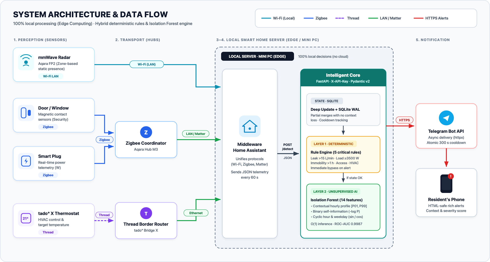

# 🏠 Smart Home Anomaly Detection System

<p align="center">
  <strong>English</strong> · <a href="README.es.md">Español</a>
</p>


[](https://github.com/Danix595/smart-home-anomaly-detection/actions/workflows/ci.yml)


Proactive smart home monitoring system focused on **home safety**, **non-invasive assisted living**, and **energy efficiency**. All telemetry is processed **100% locally (Edge Computing)**, combining a **deterministic rule engine** with **unsupervised machine learning (Isolation Forest over a contextual routine profile)** to catch both critical technical emergencies and unusual behavioral deviations without cameras or wearables.

> **Bachelor's Thesis (TFG)** — B.Sc. in Computer Engineering (Services and Applications)  
> School of Computer Engineering of Segovia, University of Valladolid (2026)  
> **Author:** Daniel López Iniesta

---

## System Architecture

The ecosystem is structured into **five decoupled layers** modeled with Domain-Driven Design (**DDD**: *Energy, Security, Comfort, Health, and Water*):

1. **Perception:** Millimeter-wave static presence radar (**Aqara FP2** over local Wi-Fi), magnetic door/window contact sensors, power-monitoring smart plugs, and smart thermostats (**tado° X**).
2. **Transport:** Local **Wi-Fi** (Aqara FP2), **Zigbee** mesh (Aqara Hub M3), and **Thread / Matter** mesh (tado° Bridge X).
3. **Middleware:** **Home Assistant** unifies heterogeneous protocols and forwards JSON home telemetry to the local server every minute (or via partial event-driven updates).
4. **Intelligent Core (this repository):** Asynchronous **FastAPI** backend protected by `X-API-Key` (constant-time verification and fail-closed startup), **SQLite (WAL mode)** persistence with recursive state merging (*Deep Update*), and a hybrid Rules → AI decision engine.
5. **Notification:** Asynchronous **Telegram** bot (`httpx`) delivering HTML-escaped rich alerts, simultaneous emergency reporting, AI severity labels, and atomic cooldown suppression (`300 s` default).



---

## Hybrid Decision Engine

Every request sent to `POST /detect` (validated through strict **Pydantic v2** schemas) merges partial payloads into the persistent home state via *Deep Update*—preserving omitted fields and ignoring empty dictionaries—and runs through two sequential layers:

### 1. Deterministic Layer ([`src/core/rules.py`](src/core/rules.py))

Evaluates **all** business rules in priority order (without hiding simultaneous emergencies) and bypasses the AI model whenever a critical condition fires:

| Rule | Code | Technical Condition | Severity |
| :--- | :--- | :--- | :--- |
| **Critical water leak** | `water_critical_high` | Water flow `> 15.0 L/min` | Critical |
| **Electrical overload** | `power_high` | Global power `>= 3500 W` | Critical |
| **Abnormal daytime immobility** | `presence_no_motion` | Presence (`08:00–22:00`) with `> 3600 s` since last motion | High |
| **Unsecured home while away** | `security_element_open_away` | Empty home (`presence == 0`) with any open door or window | High |
| **Thermal waste** | `efficiency_heating_window_open` | Heating ON with any open window | Moderate |

### 2. Predictive Layer ([`src/models/`](src/models/))

If no deterministic rule triggers, the home state is projected into **14 features** combining:

- **Unsupervised contextual routine profile** (`fit_routine_profile`, fitted exclusively on training data grouped by `(hour, is_weekend, presence)`):
  - Robust out-of-envelope excess beyond `[P01, P99]` for continuous sensors (`water_L_per_min`, `power_W`).
  - Shannon self-information (`-log P`) for binary sensors (`motion`, `window_open`, `door_open`, `heating_on`, `fp2_active`, `presence`), plus `max` and `sum` aggregates.
- **True cyclic time encoding:** `hour_sin`, `hour_cos`, `weekday_sin`, `weekday_cos`.

Inference runs in O(1) using **Isolation Forest** (`n_estimators=200`, `max_samples=2048`, `contamination=0.4%`, without `StandardScaler` since axis-aligned random trees are invariant to per-feature affine scaling). In Telegram alerts, negative anomaly scores are rescaled to an interpretable `[0, 1]` severity index (`CRÍTICO > 0.75`, `ALTO 0.60–0.75`, `MODERADO <= 0.60`).

---

## Reproducible Evaluation & Benchmarks

The repository ships a block-based yearly telemetry simulator ([`src/simulate_yearly.py`](src/simulate_yearly.py), **525,600 minutes**) and a reproducible evaluation script ([`src/models/evaluate.py`](src/models/evaluate.py)) using a **leak-free chronological 80/20 split**:

- **Training (80%):** `420,480` minutes of unlabeled normal routines.
- **Testing (20%):** `105,120` minutes with 6 injected behavioral anomaly scenarios **strictly below the deterministic thresholds of `rules.py`** (`night_water_leak`, `away_or_night_power`, `night_door_or_window`, `heating_unusual`, `night_activity_burst`, `daytime_fp2_static_power`).

| Metric | Reproducible Result (`python -m src.models.evaluate`) |
| :--- | :--- |
| **Precision (AI)** | **84.75%** (`TP: 2,100 · FP: 378`) |
| **Recall (AI)** | **100.00%** (`FN: 0` across all 6 behavioral scenarios) |
| **F1-Score** | **0.9174** |
| **False Positive Rate (FPR)** | **0.367%** (`TN: 102,642`) |
| **ROC-AUC / PR-AUC** | **0.9987** / **0.9150** |
| **`POST /detect` latency (rules bypass)** | **4.21 ms** avg (`P95: 4.61 ms · Max: 6.46 ms`, n=200) |
| **`POST /detect` latency (rules + AI)** | **9.84 ms** avg (`P95: 10.18 ms · Max: 21.87 ms`, n=200) |
| **Automated test suite (`pytest`)** | **27 passing tests** (API, auth, rules, *Deep Update*, Telegram, ML) |

<p align="center">
  
</p>

---

## Local Setup & Quickstart

### 1. Clone and install dependencies
```bash
git clone https://github.com/Danix595/smart-home-anomaly-detection.git
cd smart-home-anomaly-detection
python3 -m venv .venv
source .venv/bin/activate
pip install -r requirements.txt
```

### 2. Configure environment variables
Copy the template and set your credentials (create a Telegram bot with `@BotFather` and generate a local secret for `API_KEY`):
```bash
cp .env.example .env
```

```env
TELEGRAM_BOT_TOKEN="your_botfather_token_here"
TELEGRAM_CHAT_ID="your_chat_id_here"
API_KEY="generate_a_local_secret_key_here"
TELEGRAM_COOLDOWN_SECONDS="300"
```

### 3. Generate dataset, train, and evaluate the model
```bash
python -m src.simulate_yearly
python -m src.models.train_isolation_forest
python -m src.models.evaluate
```

### 4. Start the API and run sample scenarios
```bash
uvicorn src.api.main:app --host 127.0.0.1 --port 8000 --reload
```

In a second terminal, run the test client (reads `API_KEY` from `.env` and sends a deterministic emergency, a 03:15 AM AI behavioral anomaly, and 10 normal readings):
```bash
python scripts/send_test_data.py
```

You can also inspect individual Isolation Forest scores from the CLI:
```bash
python -m src.models.debug_predict 2026-07-02T03:15:00 6.5 1800 1 1 0 --door-open 1
```

### 5. Run the test suite
```bash
pytest -v
```

### 6. Mini PC Deployment (Docker or `systemd` + Home Assistant)

With **Docker Compose** (recommended):
```bash
cp .env.example .env   # Configure API_KEY, TELEGRAM_BOT_TOKEN, and TELEGRAM_CHAT_ID
docker compose up -d --build
docker compose exec api python -m src.simulate_yearly
docker compose exec api python -m src.models.train_isolation_forest
docker compose restart api
```

For native Linux deployment or **Home Assistant** integration, see the ready-to-use templates in [`deploy/`](deploy/):
* [`deploy/domotica.service`](deploy/domotica.service) — `systemd` unit with auto-restart (`--host 127.0.0.1 --workers 1`).
* [`deploy/home_assistant.yaml`](deploy/home_assistant.yaml) — `rest_command` (building JSON inline with Jinja2 to avoid Home Assistant's 255-character sensor state limit) plus a 1-minute automation.

---

## API Endpoints

| Method | Endpoint | Auth | Description |
| :--- | :--- | :--- | :--- |
| `GET` | `/` | None | Lightweight healthcheck (`{"status": "online"}`) exposing no private home state. |
| `GET` | `/state` | `X-API-Key` | Returns the latest consolidated home state persisted in SQLite. |
| `POST` | `/detect` | `X-API-Key` | Validates full or partial JSON telemetry, applies *Deep Update*, evaluates rules/AI, and triggers alerts. |

Interactive OpenAPI (Swagger) documentation is available at `http://127.0.0.1:8000/docs` while the server is running.

---

## Repository Structure

```text
├── .github/
│   └── workflows/
│       └── ci.yml                       # Continuous Integration (compileall + pytest)
├── deploy/
│   ├── domotica.service                 # systemd service template for Mini PC
│   └── home_assistant.yaml              # Home Assistant rest_command + automation
├── docs/
│   ├── images/
│   │   ├── alerta_telegram.png          # Real Telegram alert screenshot
│   │   ├── architecture.png             # System architecture diagram (EN)
│   │   └── arquitectura.png             # System architecture diagram (ES)
│   ├── Memoria_TFG.pdf                  # Original Bachelor's thesis report (in Spanish)
│   └── Presentacion_TFG.pdf             # Thesis defense slides (in Spanish)
├── scripts/
│   └── send_test_data.py                # Test client (rules, AI anomaly, and normal loop)
├── src/
│   ├── api/                             # FastAPI (main, routes, Pydantic schemas, auth)
│   ├── core/                            # Environment config and deterministic rules
│   ├── db/                              # SQLite WAL persistence (home_state & cooldowns)
│   ├── models/                          # Contextual profile, training, inference, eval, debug
│   ├── services/                        # Async Telegram client (httpx + HTML escaping)
│   └── simulate_yearly.py               # Block-based stochastic yearly simulator (525,600 min)
├── tests/                               # pytest suite (API, auth, rules, Telegram, ML)
├── .dockerignore
├── .env.example
├── .gitignore
├── Dockerfile
├── LICENSE
├── README.md                            # Main documentation (EN)
├── README.es.md                         # Spanish documentation (ES)
├── docker-compose.yml
├── pytest.ini
└── requirements.txt
```

---

## Production Considerations & Roadmap

This repository intentionally preserves the lightweight two-table SQLite schema (`home_state` and `cooldowns`) designed for the thesis. To evolve from a single-home prototype to a 24/7 production deployment with live hardware, the key next steps are:

1. **Real telemetry history for model retraining:** add a time-series history table (or Parquet/CSV export) to collect 2–4 weeks of actual resident routines and retrain the contextual profile and Isolation Forest on real household patterns.
2. **Multi-worker concurrency:** the server currently runs with `--workers 1` because state and cooldown `asyncio.Lock` primitives live in memory. Scaling to multi-unit buildings would migrate persistence and locking to **PostgreSQL + Redis**.
3. **Transport encryption on LAN:** when Home Assistant and this API share the same Mini PC, binding is restricted to `127.0.0.1`. For separate hosts on a LAN, place an **HTTPS/TLS reverse proxy** (Caddy or Nginx) in front of Uvicorn to protect `X-API-Key` headers in transit.

---

## Academic Documentation (Bachelor's Thesis)

* 📄 **[Full Thesis Report — `Memoria_TFG.pdf`](docs/Memoria_TFG.pdf)** *(in Spanish)* — Requirements analysis, system design, GDPR assessment, and installation/user manuals.
* 📊 **[Defense Slides — `Presentacion_TFG.pdf`](docs/Presentacion_TFG.pdf)** *(in Spanish)* — Executive and visual overview of the project.

> **Maintenance note:** The PDFs in `docs/` are preserved unmodified as the historical university submission (July 2026). The codebase in this repository includes subsequent improvements in security hardening, SQLite/Telegram concurrency, contextual ML feature engineering with leak-free reproducible evaluation, Docker packaging, and automated test coverage.
