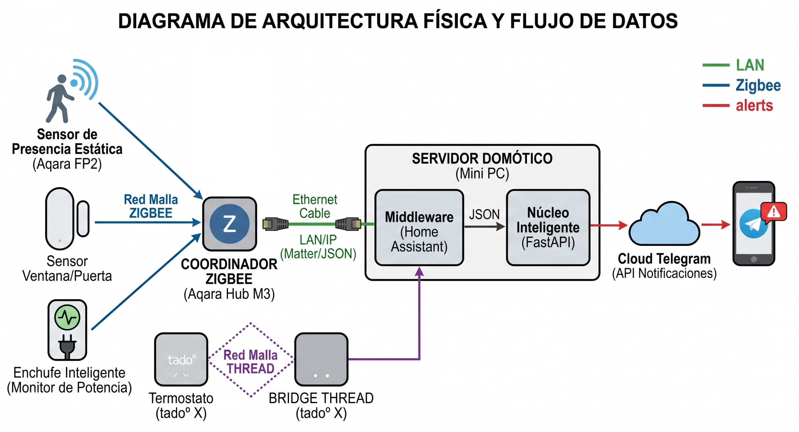

# 🏠 Sistema Domótico Inteligente con Supervisión de Anomalías


Sistema domótico proactivo orientado a la **seguridad**, la **asistencia no invasiva** y la **eficiencia energética** en el hogar. A diferencia de la domótica reactiva tradicional, procesa la telemetría de la vivienda en tiempo real de forma **100 % local (Edge Computing)** y combina un motor de reglas deterministas con aprendizaje automático no supervisado (**Isolation Forest**) para detectar tanto emergencias técnicas inmediatas como desviaciones de comportamiento (por ejemplo, posibles caídas o inmovilidad prolongada sin recurrir a cámaras).

> **Trabajo de Fin de Grado** — Grado en Ingeniería Informática de Servicios y Aplicaciones  
> Escuela de Ingeniería Informática de Segovia, Universidad de Valladolid (2026)  
> **Autor:** Daniel López Iniesta

---

## Arquitectura del Sistema

El ecosistema se organiza en una arquitectura de **cinco capas** desacopladas y un diseño orientado a dominios (**DDD**: *Energía, Seguridad, Confort, Salud y Agua*):

1. **Percepción:** Sensores de presencia estática por radar de ondas milimétricas (Aqara FP2), contactos de puertas/ventanas, enchufes con telemetría eléctrica y termostatos inteligentes (tado° X).
2. **Transporte:** Redes locales **Zigbee** (Aqara Hub M3) y **Thread / Matter** (tado° Bridge X).
3. **Middleware:** **Home Assistant** unifica la telemetría y envía el estado en formato JSON cada minuto.
4. **Núcleo Inteligente (este repositorio):** API en **FastAPI** con persistencia en **SQLite** mediante fusión recursiva (*Deep Update*) y evaluación híbrida (Reglas → IA).
5. **Notificación:** Bot de **Telegram** asíncrono (`httpx`) con alertas HTML enriquecidas, niveles de gravedad y control de *cooldown* de 300 s para evitar spam.



---

## Motor de Decisión Híbrido

Cada petición recibida en `POST /detect` (autenticada mediante cabecera `X-API-Key`) actualiza el estado persistente sin perder los campos ausentes (*Deep Update*) y pasa por dos capas secuenciales:

### 1. Capa Determinista (`src/core/rules.py`)
Intercepta emergencias técnicas y descuidos críticos con *bypass* directo a la IA:

| Regla | Condición técnica | Gravedad |
| :--- | :--- | :--- |
| **Fuga crítica de agua** | Caudal $> 15,0\text{ L/min}$ | Crítica |
| **Sobrecarga eléctrica** | Potencia global $> 3500\text{ W}$ | Crítica |
| **Inactividad anómala** | Presencia (08:00–22:00) sin movimiento $> 3600\text{ s}$ | Alta |
| **Seguridad (olvido)** | Vivienda vacía con puertas o ventanas abiertas | Alta |
| **Derroche térmico** | Calefacción encendida con ventana abierta | Moderada |

### 2. Capa Predictiva (`src/models/`)
Si el estado supera las reglas deterministas, el sistema extrae variables temporales cíclicas ($\sin/\cos$ de hora y día de la semana), normaliza con `StandardScaler` y evalúa el vector con **Isolation Forest** (contaminación configurada al `0,5 %`). El *score* se reescala a un índice de gravedad interpretable entre `0` y `1` (`CRÍTICO > 0,75`, `ALTO 0,60–0,75`, `MODERADO < 0,60`).

---

## Resultados de Evaluación

Validado sobre un dataset sintético de **1 año completo (525.600 minutos)** generado con rutinas diferenciadas entre días laborables y fines de semana, más pruebas de estrés e inyección de fallos:

| Métrica | Resultado |
| :--- | :--- |
| **Precision (IA)** | **91,8 %** (TP: 2.492 / FP: 222) |
| **Recall (IA)** | **94,8 %** (FN: 136) |
| **F1-Score** | **0,932** |
| **Latencia media API** (10.000 peticiones) | **1,2 ms** (P95: 2,5 ms · Máx: 15,4 ms) |
| **Tolerancia a fallos** | Validada ante JSON parciales, desconexión de sensores, caídas de Telegram y accesos HTTP 403 |

<p align="center">
  
</p>

---

## Puesta en Marcha Local

### 1. Clonar e instalar dependencias
```bash
git clone [https://github.com/TU_USUARIO/TU_REPO.git](https://github.com/TU_USUARIO/TU_REPO.git)
cd TU_REPO
python3 -m venv .venv
source .venv/bin/activate
pip install -r requirements.txt
```

### 2. Configurar variables de entorno
Copia la plantilla y rellena tus credenciales (crea un bot con `@BotFather` en Telegram):
```bash
cp .env.example .env
```

```env
TELEGRAM_BOT_TOKEN="tu_token_de_botfather"
TELEGRAM_CHAT_ID="tu_chat_id"
API_KEY="tu_clave_local_secreta"
```

### 3. Generar dataset sintético y entrenar el modelo
```bash
python -m src.simulate_yearly
python -m src.models.train_isolation_forest
```

### 4. Arrancar la API y probar escenarios
```bash
uvicorn src.api.main:app --host 0.0.0.0 --port 8000 --reload
```

En otra terminal, lanza el script de simulación de escenarios (comportamiento normal, fuga masiva y anomalía compleja):
```bash
python scripts/send_test_data.py
```

---

## Endpoints de la API

| Método | Endpoint | Auth | Descripción |
| :--- | :--- | :--- | :--- |
| `GET` | `/` | No | *Healthcheck* y volcado del último estado guardado en SQLite. |
| `POST` | `/detect` | `X-API-Key` | Recibe telemetría JSON (completa o parcial), aplica *Deep Update*, evalúa reglas/IA y dispara alertas. |

La documentación interactiva OpenAPI (Swagger) queda disponible en `http://127.0.0.1:8000/docs` al iniciar el servidor.

---

## Estructura del Repositorio

```text
├── docs/
│   ├── Memoria_TFG.pdf          # Memoria completa del proyecto
│   └── Presentacion_TFG.pdf     # Diapositivas de la defensa
├── scripts/
│   └── send_test_data.py        # Inyección de escenarios críticos y pruebas
├── src/
│   ├── api/                     # Rutas FastAPI, esquemas Pydantic y seguridad
│   ├── core/                    # Configuración y motor de reglas deterministas
│   ├── db/                      # Persistencia SQLite (home_state y cooldowns)
│   ├── models/                  # Feature engineering, entrenamiento e inferencia IA
│   ├── services/                # Cliente asíncrono de Telegram y formateo HTML
│   └── simulate_yearly.py       # Generador estocástico de telemetría anual
├── .env.example
├── .gitignore
└── requirements.txt
```

---

## Documentación Adicional

* 📄 **[Memoria completa del TFG (PDF)](docs/Memoria_TFG.pdf)** — Análisis de requisitos, diseño, pruebas, RGPD y manuales de instalación y usuario.
* 📊 **[Presentación de la defensa (PDF)](docs/Presentacion_TFG.pdf)** — Resumen ejecutivo y visual del proyecto.
